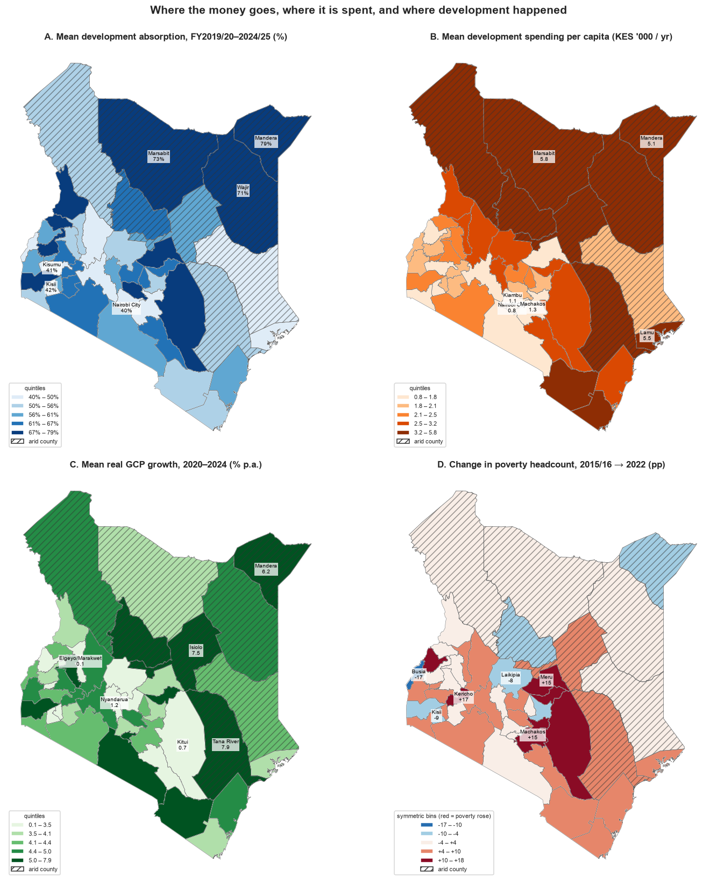

# Econometrics in Action
## Budget Absorption and Development Outcomes under Devolution in Kenya

**Author:** Peter Elman · **Date:** 3 November 2026

Kenya's 2010 Constitution assigned a guaranteed share of national revenue to 47 county governments. Twelve years and KES 4.36 trillion later, public debate about devolution centres on a single indicator — the **development absorption rate**, the share of the approved development budget that counties actually spend. This project asks whether that indicator is informative about development outcomes.

It assembles a **47-county × 12-year panel (FY2013/14 – FY2024/25)** from the Controller of Budget's annual implementation reports, Commission on Revenue Allocation schedules, National Treasury exchequer data, KNBS Gross County Product estimates (2013–2024), two household poverty surveys (2015/16, 2022) and the census, and relates absorption and development spending to real GCP growth, poverty change and project completion.



### Key findings

| | Finding |
|---|---|
| **Flow of funds** | KES 4.36 tn released since FY2013/14; releases exceeded county spending in every year. Only 27 % went to development (22–26 % recently, below the PFM Act's 30 % threshold). KES 867 bn of approved development budgets went unspent. |
| **Absorption (H1)** | Development absorption has ranged 36–65 % with no trend; recurrent absorption 83–93 %. Only 40 % of variation is between counties — 60 % is year-to-year noise (AR(1) = 0.27). |
| **Growth (H2)** | No specification — pooled, two-way fixed effects, lagged, extended panel, 400-draw cluster bootstrap (95 % CI −0.96 to +0.45 pp per 10 pp), or a tuned neural network — detects an association between the absorption *rate* and real GCP growth. Development *spending per capita* is associated with next-year growth (+0.4 pp per 10 %, p < 0.01). |
| **Poverty (H3)** | Decade-average absorption has a modest association with smaller poverty increases (−1.8 pp per 10 pp, p < 0.05); the association vanishes with a 3-year window. |
| **Projects (H4)** | 30 % of 762 flagship projects complete in FY2022/23; unrelated to absorption. Pending bills grew from KES 35 bn to 183 bn. |
| **Redistribution** | The eight arid counties — largest per-capita recipients — grew 1.9 pp/yr faster in 2020–24 and saw poverty rise less (+1.2 pp vs +3.7 pp). |

**Assessment:** devolved transfers have redistributed resources and are associated with growth where spent, but the absorption rate — the indicator most used to judge counties — is a weak proxy for development outcomes.

### Repository contents

```
Kenya_County_Absorption_and_Development.ipynb   Full analysis notebook (52 cells, executed)
Kenya_County_Absorption_and_Development_Report.html   Static HTML export of the notebook
county_absorption_figures/      12 figures (conceptual framework, flows, maps, regressions, bootstrap, NN benchmark)
data/
  county_fiscal_panel.csv       47 × 12 county-year fiscal panel (COB, CRA, Treasury)
  national_fiscal_aggregates.csv  National totals by fiscal year (COB)
  county_gcp.csv                Gross County Product 2013–2024 (KNBS)
  county_poverty.csv            Poverty headcount 2015/16 and 2022 (KNBS)
  county_population.csv         Census population 2009 and 2019 (KNBS)
  county_projects.csv           Flagship project completion FY2022/23 (COB)
  kenya_counties.geojson        County boundaries (geoBoundaries ADM1, public domain)
  appendix_model_summary.csv    All 25 regression models in one table
  sources.md, outcome_sources.md  Provenance: URL and table for every data point
linkedin/                       Carousel PDF and post copy used to share the results
requirements.txt
```

### Reproducing the analysis

```bash
pip install -r requirements.txt
jupyter nbconvert --to notebook --execute --inplace Kenya_County_Absorption_and_Development.ipynb
```

Runs in about two minutes (most of it in the cluster bootstrap and cross-validated model comparison). All random components are seeded (`523`). Figures are written to `county_absorption_figures/`.

### Methods

Two-way fixed-effects panel regressions (`linearmodels`), long-difference cross-sections, county cluster bootstrap, county-grouped cross-validated MLP / random forest / ridge benchmark (`scikit-learn`), choropleth mapping (`geopandas`). Data-quality rules are applied in code and documented in the notebook's Reproducibility section: transfer values below KES 100 m treated as parse errors; pre-FY2019/20 county rows used only when expenditure ÷ budget reproduces the reported absorption rate within 3 pp.

### Data sources

- Office of the Controller of Budget — *Annual County Governments Budget Implementation Review Reports*, FY2013/14–FY2024/25 (FY2013/14–2018/19 recovered from Wayback Machine archives of cob.go.ke)
- Commission on Revenue Allocation — County Allocation of Revenue Acts
- Kenya National Bureau of Statistics — *Gross County Product* (2019, 2021, 2023, 2025 editions); *Basic Report on Well-Being* (KIHBS 2015/16); *Kenya Poverty Report 2022*; 2009 and 2019 Population and Housing Census
- geoBoundaries (Runfola et al. 2020), Kenya ADM1, public domain

Every number in `data/` traces to a cited official table; see `data/sources.md` and `data/outcome_sources.md`.

### Limitations

Consolidated county-level COB tables exist only from FY2019/20; earlier county rows were extracted from narrative text and used only where internally consistent. Real GCP is a KNBS estimate, poverty is observed at two points, and the design is observational — the spending coefficients are subject to reverse causality through the CRA allocation formula. See the notebook's Limitations section.

### Licence

Code and text: MIT (see `LICENSE`). Data files are compiled from public documents of the Government of Kenya (Controller of Budget, CRA, National Treasury, KNBS) and from geoBoundaries (public domain); please cite the original sources.

### Citation

> Elman, P. (2026). *Econometrics in Action: Budget Absorption and Development Outcomes under Devolution in Kenya, FY2013/14–FY2024/25.* https://github.com/elmanpeter/econometrics-in-action
